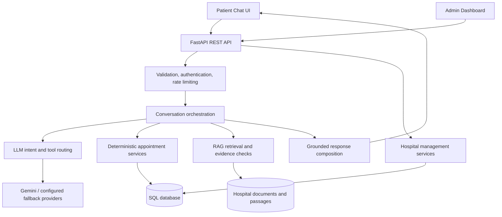

<div align="center">

# 🏥 Hospital AI Assistant

### Intelligent hospital reception, reliable appointment workflows, and grounded AI answers — in one platform.

**A multilingual, full-stack hospital assistant powered by Generative AI, FastAPI, and Retrieval-Augmented Generation (RAG).**

[](https://www.python.org/)
[](https://fastapi.tiangolo.com/)
[](https://www.sqlite.org/)
[](https://developer.mozilla.org/en-US/docs/Web/JavaScript)
[](#project-status--limitations)

[**Features**](#key-features) · [**Screenshots**](#interface-preview) · [**Quick Start**](#quick-start-windows-powershell) · [**Architecture**](#system-architecture) · [**API**](#api--developer-tools) · [**Security**](#security--patient-safety)

</div>

---

> [!IMPORTANT]
> **Development / academic demonstration:** This software is not a medical device or a substitute for professional healthcare. The current project postpones end-to-end OTP verification. **Do not use real patient information or expose sensitive patient actions publicly** until identity verification, privacy review, and clinical safety validation are completed.

## Overview

**Hospital AI Assistant** is a full-stack AI-powered virtual receptionist for hospitals and clinics. Patients can talk naturally to a hospital assistant, find information about doctors and services, check appointment availability, and start appointment booking, cancellation, or rescheduling workflows.

A large language model (LLM) interprets what the patient means, while **deterministic backend services** validate schedules, enforce appointment rules, and make database changes. Hospital-specific questions can be answered with **RAG**, which retrieves relevant evidence from uploaded documents instead of relying only on the model's general knowledge.

The system includes two responsive interfaces:

- **Patient Portal:** AI conversation, doctor discovery, appointment services, feedback, and support.
- **Administration Dashboard:** hospital staff management of doctors, schedules, appointments, patients, services, documents, FAQs, and AI activity.

### Why this project is different

- **Conversation-first:** A greeting is treated as a greeting, not as an appointment request.
- **Action-aware AI:** Models select workflows; the backend validates and performs actions.
- **Context-aware:** Handles follow-ups, interruptions, corrections, and task switching.
- **Multilingual:** Designed for English, Urdu, Roman Urdu, and mixed-language messages.
- **Evidence-based:** Hospital document answers are checked against retrieved knowledge.
- **Reliability-focused:** Provider fallback, circuit breakers, rate limiting, validation, and audit trails.

## Interface preview

> Screenshots below are from a **local UI demonstration with illustrative content and sample statistics**; they are not live hospital metrics or proof of deployed functionality.

### Administration dashboard


### Patient chat


<details>
<summary><strong>📱 View mobile previews</strong></summary>

| Admin dashboard | Patient chat |
|---|---|
|  |  |

</details>

## Key features

| Area | Capabilities |
|---|---|
| 💬 **AI receptionist** | Natural conversation, greetings, follow-up questions, intent identification, and conversational replies |
| 🌐 **Multilingual interaction** | English, Urdu, Roman Urdu, and mixed-language conversation support |
| 🧠 **Conversation state** | Active workflow drafts, session context, interruptions, and task switching |
| 🩺 **Doctor discovery** | Browse doctors, departments, and applicable schedules stored in the hospital database |
| 📅 **Appointment workflows** | Check available slots, book, reschedule, and cancel within backend validation rules |
| 🔐 **Appointment consistency** | Duplicate-slot protection and database-level uniqueness constraints |
| 📚 **RAG knowledge base** | Upload PDF, DOCX, or TXT files; retrieve relevant passages for grounded hospital answers |
| 🧪 **General health information** | General informational guidance with safety boundaries and urgent-care escalation logic |
| 🏢 **Admin operations** | Manage hospital data, staff, patients, appointments, schedules, services, FAQs, and laboratory information |
| 📈 **Monitoring** | AI-call logs, provider health, latency, feedback, unanswered questions, and audit records |
| 🛡️ **Backend controls** | JWT-based staff authentication, role checks, rate limiting, request validation, and tenant scoping |

> **Note:** The feature list describes implemented code paths and development functionality, not an independently certified production service. Live LLM reliability, end-to-end clinical safety, and sensitive-action authorization require further verification.

## Technology stack

| Layer | Technology |
|---|---|
| Backend API | **Python**, **FastAPI**, **Uvicorn** |
| Data & validation | **SQLAlchemy**, **Pydantic** |
| Primary local database | **SQLite** (PostgreSQL configuration supported for future scaling) |
| AI providers | **Google Gemini**, optional **DeepSeek**, and a configurable **OpenAI-compatible custom provider** |
| AI orchestration | Intent interpretation, structured tool routing, LLM-generated final responses |
| Knowledge retrieval | RAG, text chunking, embedding-based retrieval, reranking, evidence validation |
| Frontends | **HTML5**, **CSS3**, **Vanilla JavaScript** (no React build step required) |
| Authentication | **JWT**, **bcrypt / passlib** for staff accounts |
| Quality checks | **pytest**, integration scripts, API health/preflight checks |
| Container deployment | **Docker Compose**, **Nginx** for static frontends |

## System architecture



### How a patient request works

1. **Message:** A patient sends a request to `POST /api/v1/chat/message`.
2. **Understanding:** The LLM identifies the current intention and relevant conversation context.
3. **Routing:** The backend selects a relevant read-only query or appointment action.
4. **Validation:** Doctor identity, schedules, date/time, conflicts, and other rules are checked against stored records.
5. **Execution:** Approved changes are made by backend services, **not directly by the LLM**.
6. **Reply:** The assistant responds naturally using verified results and the patient's language preference.

For document questions, the RAG subsystem retrieves hospital-specific passages and applies evidence checks before producing a grounded answer.

## Project structure

```text
hospital-ai-assistant/
├── backend/
│   ├── app/
│   │   ├── api/                  # Versioned FastAPI endpoints and dependencies
│   │   ├── core/                 # Configuration, authentication and policies
│   │   ├── db/                   # Database engine and sessions
│   │   ├── models/               # SQLAlchemy database models
│   │   ├── schemas/              # Request and response schemas
│   │   ├── services/             # Chat, booking, RAG and AI services
│   │   └── main.py               # FastAPI entry point
│   ├── scripts/                  # Admin setup, maintenance and checks
│   ├── tests/                    # Automated backend tests
│   ├── eval/                     # Sample RAG evaluation cases
│   ├── .env.example              # Safe example configuration
│   ├── requirements.txt
│   └── requirements-dev.txt
├── frontend/
│   ├── admin-dashboard/          # Responsive staff interface
│   └── patient-chat/             # Responsive patient interface
├── docs/
│   └── screenshots/              # README interface previews
├── docker/
├── sample_data/                  # Synthetic RAG demonstration documents
├── docker-compose.yml
├── .gitignore
└── README.md
```

## Quick start (Windows PowerShell)

**Requirements:** Python 3.10+ (Python 3.12 is used in the Docker image), Git, and at least one supported AI-provider API key. Start from the project root.

### 1. Create the backend environment

```powershell
cd "C:\path\to\hospital-ai-assistant\backend"
python -m venv .venv
.\.venv\Scripts\Activate.ps1
python -m pip install --upgrade pip
pip install -r requirements.txt
```

If PowerShell blocks environment activation, you can run `\.venv\Scripts\python.exe` in place of `python` without changing execution policy.

### 2. Configure environment variables

```powershell
Copy-Item .env.example .env
python -c "import secrets; print(secrets.token_urlsafe(48))"
```

Open `backend/.env`. Paste the generated random value into `SECRET_KEY`, then add your chosen AI-provider credentials. A minimal development example is:

```dotenv
APP_ENV=development
DATABASE_URL=sqlite:///./hospital_ai.db
SECRET_KEY=replace_with_your_generated_random_secret

CORS_ORIGINS=http://127.0.0.1:5500,http://localhost:5500,http://127.0.0.1:5600,http://localhost:5600

LLM_PRIMARY_PROVIDER=gemini
LLM_SECONDARY_PROVIDER=
LLM_TERTIARY_PROVIDER=
GEMINI_API_KEY=your_gemini_api_key
GEMINI_MODEL=gemini-2.5-flash

RATE_LIMIT_ENABLED=true
OTP_REQUIRED_FOR_SENSITIVE_ACTIONS=false
ALLOW_INSECURE_PUBLIC_ACTIONS=false
```

**Keep all other entries from `.env.example` as needed.** To use fallback, configure a supported secondary provider and its actual model/key. Having a key in `.env` does not guarantee that a remote provider is reachable or enabled for your account.

> [!CAUTION]
> Never upload `.env`, API keys, real patient records, SQLite databases, local backups, or private hospital documents to GitHub. Use **synthetic test data** while identity verification is deferred.

### 3. Create a hospital administrator

From `backend/`:

```powershell
python scripts/create_admin.py --email admin@example.com --name "Hospital Admin" --hospital-name "Demo Hospital"
```

You will be prompted to set a strong password. No default admin password is provided.

### 4. Start the API

```powershell
python -m uvicorn app.main:app --reload
```

- API health: **http://127.0.0.1:8000/health**
- Interactive API docs: **http://127.0.0.1:8000/docs**
- API base: **http://127.0.0.1:8000/api/v1**

### 5. Start the frontends

Use **two additional PowerShell terminals**, starting from the project root:

**Admin dashboard**

```powershell
cd frontend/admin-dashboard
python -m http.server 5500
```

Open **http://127.0.0.1:5500**.

**Patient chat**

```powershell
cd frontend/patient-chat
python -m http.server 5600
```

Open **http://127.0.0.1:5600**.

Both frontends read their own `config.js`. Set `API_BASE_URL` and `HOSPITAL_ID` there if needed. The backend's `CORS_ORIGINS` must allow the frontend origins. Avoid editing the working API integrations inside `app.js` just to change addresses.

### 6. Populate demo hospital data

Sign in to the admin dashboard and add a hospital's **doctors and schedules** first. Then add departments, services, lab tests, FAQs, and a synthetic knowledge-base document. Appointment slots are only offered when actual schedules and booking rules permit them.

## Run with Docker Compose

From the project root:

```powershell
Copy-Item backend/.env.example backend/.env
# Edit backend/.env and set SECRET_KEY plus a valid AI-provider key

docker compose up --build -d
docker compose exec api python scripts/create_admin.py --email admin@example.com --name "Hospital Admin" --hospital-name "Demo Hospital"
```

The provided Compose file exposes the API on **8000**, admin dashboard on **5500**, and patient chat on **5600**. SQLite data and uploads use named Docker volumes for persistence.

> Docker Compose is a local/self-hosted option. Publishing code to GitHub **does not automatically deploy** this application.

## API & developer tools

| Resource | Endpoint / command | Notes |
|---|---|---|
| API health | `GET /health` | Returns `{"status": "ok"}` when the API can reach its database |
| API reference | `GET /docs` | Swagger UI provided by FastAPI |
| Patient chat | `POST /api/v1/chat/message` | Public chat request with rate limiting |
| Staff auth | `/api/v1/auth/...` | JWT-based staff access |
| Appointments | `/api/v1/appointments/...` | Staff appointment management |
| Public booking | `/api/v1/public/...` | Public appointment workflows; sensitive-action protections must be reviewed |
| Documents & RAG | `/api/v1/documents/...`, `/api/v1/rag/...` | Hospital knowledge base |
| Monitoring | `/api/v1/observability/llm-summary` | Admin-protected AI metrics |

### Automated tests

```powershell
cd backend
pip install -r requirements-dev.txt
python -m pytest
```

### Optional additional validation scripts

If the later development scripts have been copied into your local `backend/scripts/` folder:

```powershell
python scripts/backend_preflight.py --api-url http://127.0.0.1:8000
python scripts/check_chat_integration.py
python scripts/check_ai_providers.py
```

Provider tests that contact real AI APIs are **opt-in**, consume external API quota, and depend on your credentials and provider availability.

**Latest locally reported checks (October 2026):** 16/16 backend preflight checks passed with one deliberate OTP warning; 6/6 isolated chat integration checks passed using synthetic data and simulated LLM output. These checks do **not** establish clinical or production readiness.

### RAG sample evaluation

The `sample_data/` folder includes a **synthetic clinic knowledge-base PDF**. After uploading it to a demo hospital, the existing evaluation runner can check retrieval and grounded answers:

```powershell
cd backend
python run_rag_eval.py --hospital-id 1 --cases eval/bashir_clinic_rag_eval.json --mode embedding
python run_rag_eval.py --hospital-id 1 --cases eval/bashir_clinic_rag_eval.json --mode full
```

The `full` mode requires configured LLM access and may use paid/request-limited API calls.

## Security & patient safety

The code includes defenses such as staff JWT authentication, role-based authorization, per-hospital data scoping, request rate limits, booking uniqueness indexes, upload restrictions, masked diagnostics, and verified SQLite backups.

**Important outstanding restrictions:**

- **Patient identity verification:** End-to-end OTP has been intentionally postponed. Sensitive appointment lookup, cancellation, and rescheduling must **not** be exposed for real-patient self-service until appropriate authentication and authorization are enforced.
- **Clinical use:** The assistant is not a licensed clinician. Emergency detection and informational guidance are not substitutes for medical assessment; safety behavior needs professional review and extensive testing.
- **Provider availability:** Gemini and other AI services may time out, return HTTP 429/503, or become unavailable. Configured fallback improves resilience but does not guarantee service.
- **Patient privacy:** Do not use real PHI in public demos, issues, screenshots, prompts, or test logs. Review third-party AI-provider data handling before processing real records.
- **Scaling:** SQLite and in-memory rate limiters are suitable primarily for local/single-instance development. More demanding deployment needs an appropriate database, shared state, observability, and managed migrations.

**No HIPAA, GDPR, or medical-device compliance certification is claimed by this repository.**

## Project status & limitations

| Area | Current status |
|---|---|
| FastAPI API and database checks | Local health and database preflight checks passed |
| Chat booking integration | Passed isolated tests with synthetic records and mocked LLM responses |
| English / Urdu / Roman Urdu | Implemented with ongoing need for live quality evaluation |
| RAG and source grounding | Implemented; real-document and live-provider evaluation is ongoing |
| Redesigned frontends | Responsive UI completed; full production-browser testing remains |
| AI provider fallback | Implemented; real provider access and failover require live validation |
| OTP for sensitive actions | **Postponed — not ready for public patient use** |
| Production deployment | Not completed / not certified for clinical use |

### Next engineering milestones

1. Validate actual Gemini and secondary-provider responses under normal and overloaded conditions.
2. Run longer multilingual conversations and full chatbot-to-database tests.
3. Finish patient identity protection and authorization before any real patient deployment.
4. Complete RAG factuality, emergency handling, and medical-safety reviews.
5. Add repeatable database migrations and production-grade monitoring/backups as needed.

## Repository hygiene

The root `.gitignore` is intended to exclude secrets, databases, backups, uploads, temporary files, and local environments. Before publishing a commit, inspect the staging area:

```powershell
git status --short
git diff --cached --name-only
```

If credentials or patient data were **ever committed previously**, ignoring them now is insufficient: rotate compromised keys and remove sensitive material from Git history before sharing the repository.

## Maintainer & license

Maintained as a development project by [@moheezkiani01](https://github.com/moheezkiani01).

**License:** No open-source license is supplied by default. Add a `LICENSE` file if you intend to grant others permission to reuse or distribute the code.

---

<div align="center">

**Built to make hospital communication more accessible — with verified workflows and responsible AI boundaries.**

[Back to top](#-hospital-ai-assistant)

</div>
